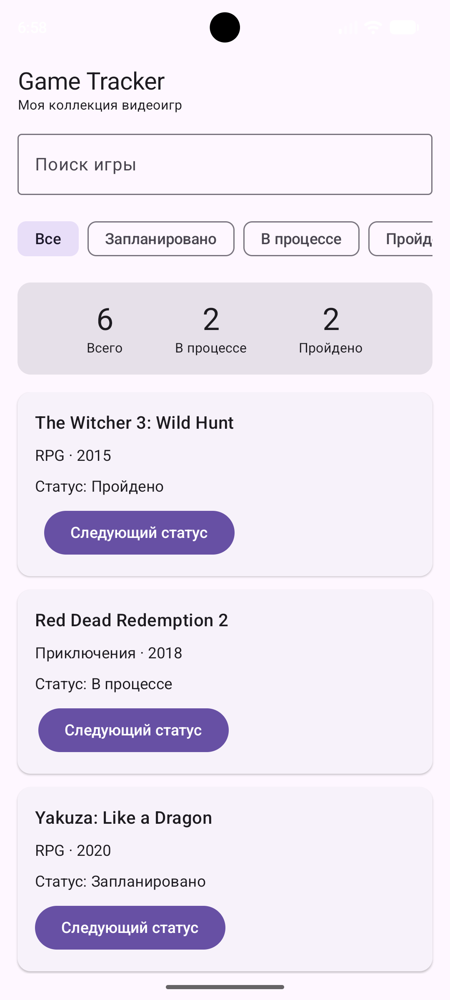
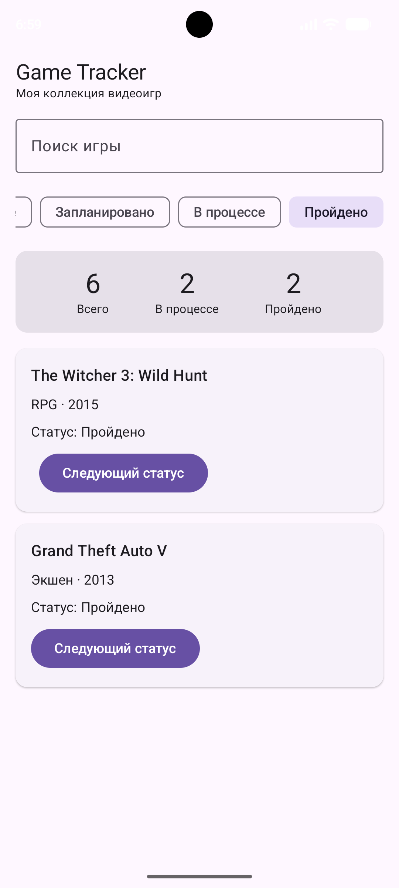
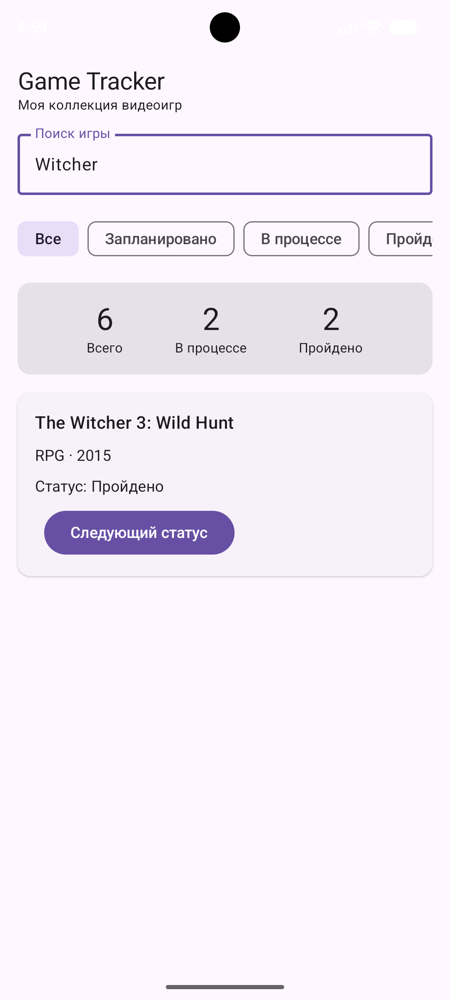
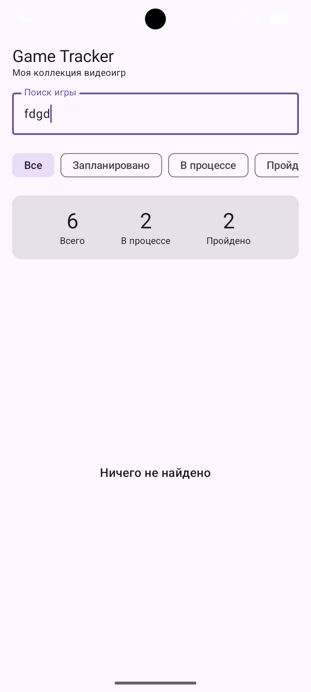

# Game Tracker – Коллекция видеоигр

## Информация о проекте

**Студент:** Пташков Александр Сергеевич  
**Группа:** Б9124-09.03.03пикд  
**Домашнее задание № 1:** Game Tracker

## Описание приложения

Game Tracker – мобильное офлайн-приложение для просмотра коллекции видеоигр и отслеживания статусов их прохождения.

Приложение позволяет искать игры по названию, фильтровать их по статусу прохождения, изменять статус и просматривать статистику коллекции.

## Функциональные возможности

- Просмотр списка видеоигр с указанием названия, жанра и года выпуска.
- Поиск игр по названию без учёта регистра.
- Фильтрация по статусам «Все», «Запланировано», «В процессе», «Пройдено».
- Изменение статуса игры с автоматическим обновлением интерфейса.
- Отображение статистики по коллекции.
- Отображение сообщения «Ничего не найдено» при отсутствии результатов поиска.

## Скриншоты

### 1. Главный экран

### 2. Фильтрация игр

### 3. Поиск игры

### 4. Поиск без результатов

