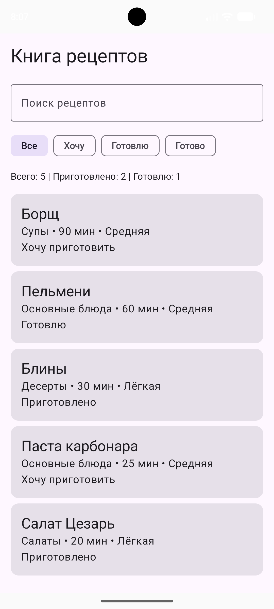
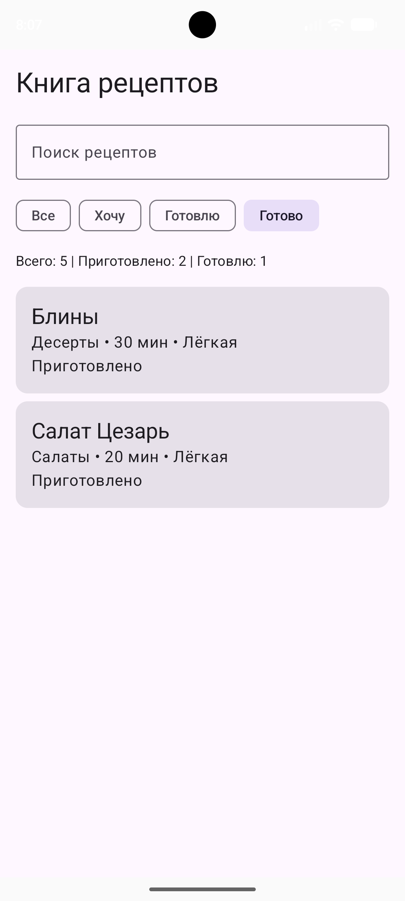
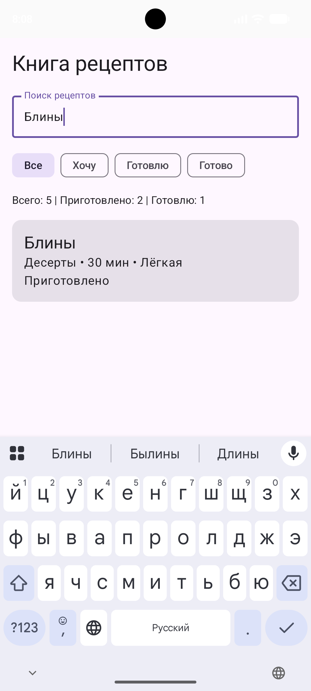
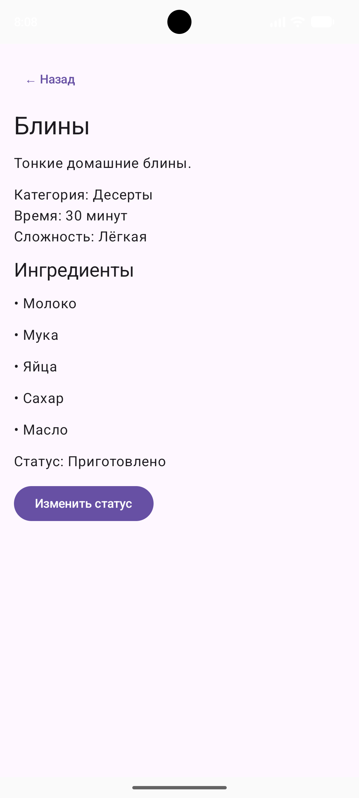

# Recipe Book – Книга рецептов

## Информация о проекте

**Студент:** Пташков Александр Сергеевич  
**Группа:** Б9124-09.03.03пикд  
**Домашнее задание № 2:** Recipe Book – ViewModel + Navigation

## Описание приложения

Recipe Book – мобильное офлайн-приложение для просмотра и управления коллекцией кулинарных рецептов, разработанное на языке Kotlin с использованием Jetpack Compose.

Приложение позволяет просматривать рецепты, искать блюда по названию, фильтровать их по статусу приготовления и получать подробную информацию о каждом блюде.

## Функциональные возможности

- Просмотр списка рецептов с указанием категории, времени приготовления, сложности и статуса.
- Поиск рецептов по названию.
- Фильтрация по статусам «Хочу приготовить», «Готовлю», «Приготовлено».
- Просмотр подробной информации о рецепте, включая описание и ингредиенты.
- Изменение статуса приготовления.
- Отображение статистики по количеству рецептов.
- Навигация между списком рецептов и экраном деталей.
- Отображение сообщения при отсутствии результатов поиска.
## Скриншоты

### 1. Главный экран

### 2. Фильтрация рецептов

### 3. Поиск рецепта

### 4. Детали рецепта

