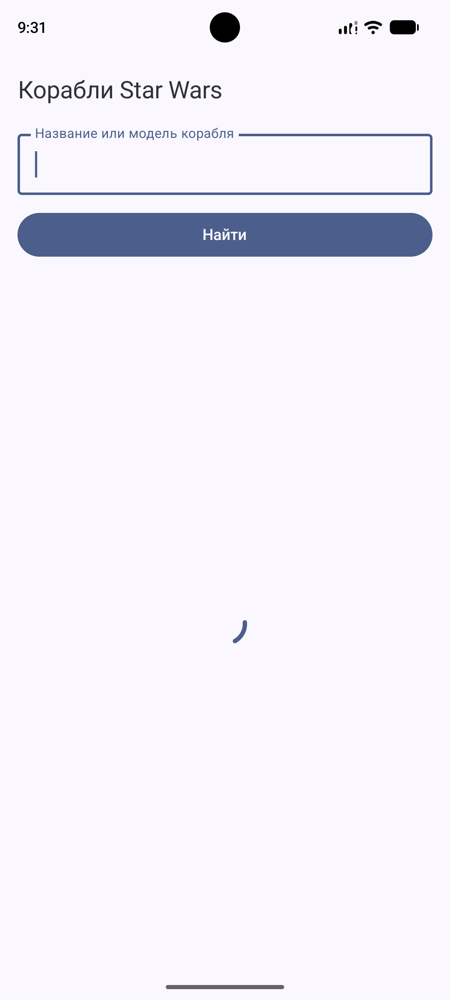
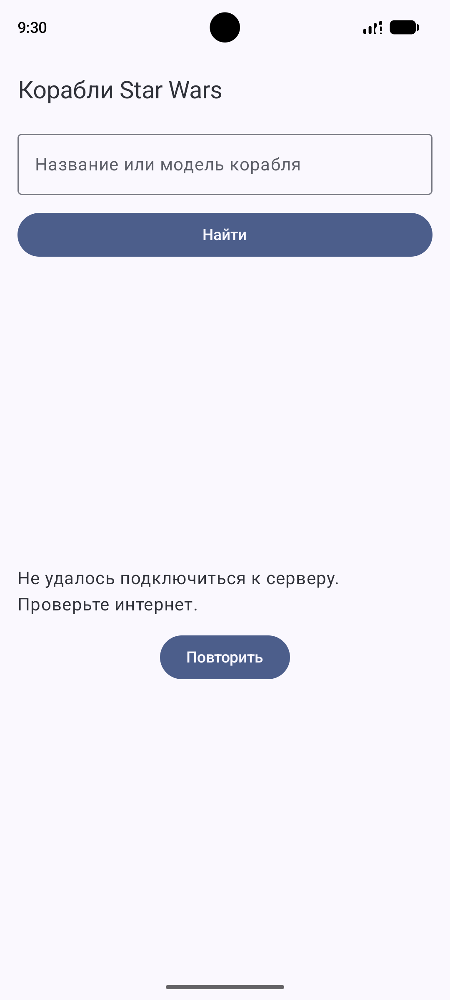
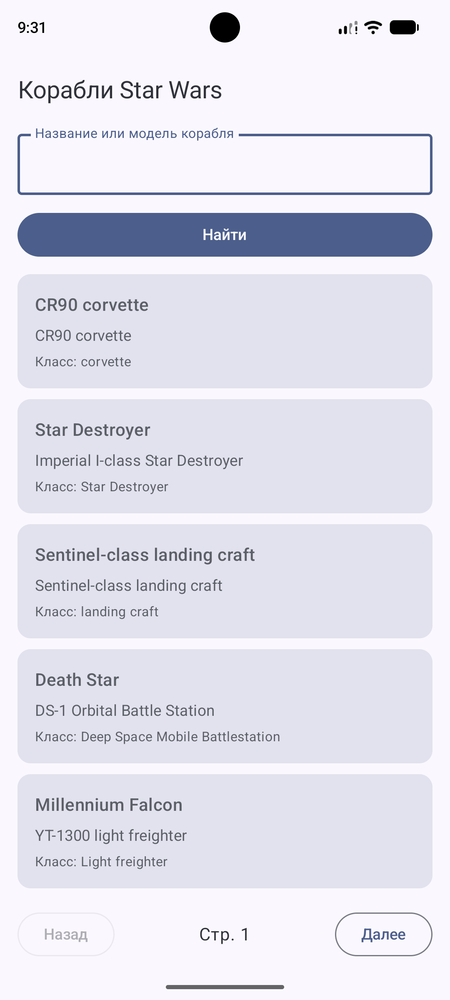
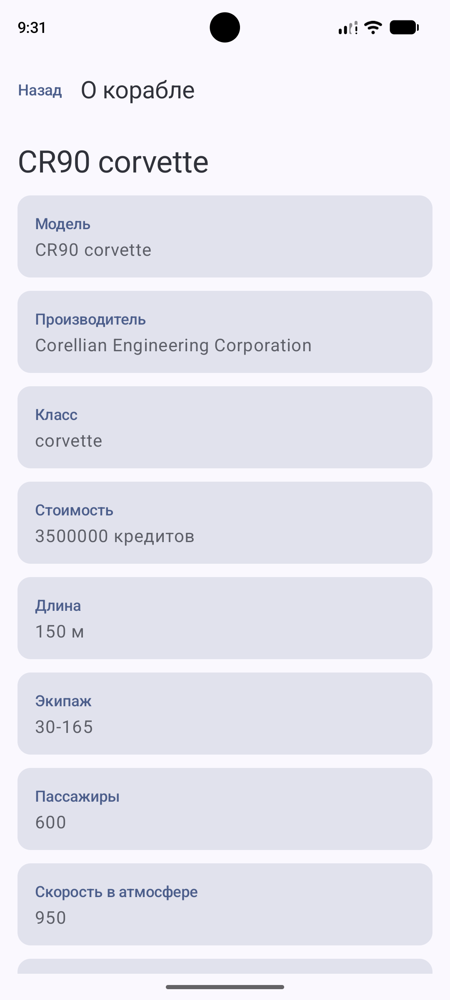
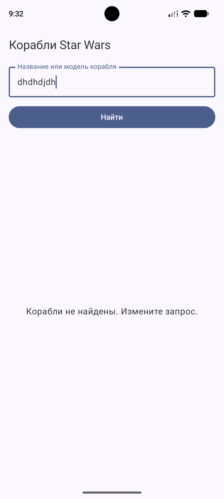

# Starships – Космические корабли Star Wars

## Информация о проекте

**Студент:** Пташков Александр Сергеевич  
**Группа:** Б9124-09.03.03пикд  
**Домашнее задание № 3:** Starships – работа с открытым API

## Описание приложения

Starships – мобильное приложение для просмотра космических кораблей из вселенной Star Wars.

Приложение позволяет просматривать список кораблей, искать их по названию или модели, переключать страницы результатов и получать подробную информацию о каждом корабле.

## Используемый API

Приложение использует SWAPI – Star Wars API. Выбранный ресурс – Starships.

API предоставляет сведения о названии, модели, производителе, классе и характеристиках космических кораблей.

Базовый адрес – https://swapi.dev/api/

- `GET /starships/?page=1` – получение списка кораблей.
- `GET /starships/?search=Falcon&page=1` – поиск кораблей.
- `GET /starships/{id}/` – получение подробной информации о корабле.

API-ключ и авторизация не требуются.

## Функциональные возможности

- Просмотр списка кораблей с указанием названия, модели и класса.
- Поиск кораблей по названию или модели.
- Переключение страниц списка и результатов поиска.
- Просмотр подробной информации о корабле, включая производителя, стоимость, длину, экипаж, вместимость и характеристики гипердвигателя.
- Навигация между списком кораблей и экраном деталей с передачей идентификатора через маршрут `detail/{id}`.
- Отображение индикатора во время загрузки данных.
- Отображение сообщения об ошибке и повтор запроса по кнопке «Повторить».
- Отображение сообщения при отсутствии результатов поиска.

## Скриншоты

### 1. Загрузка данных

### 2. Ошибка загрузки

### 3. Главный экран

### 4. Детали корабля

### 5. Отсутствие результата

